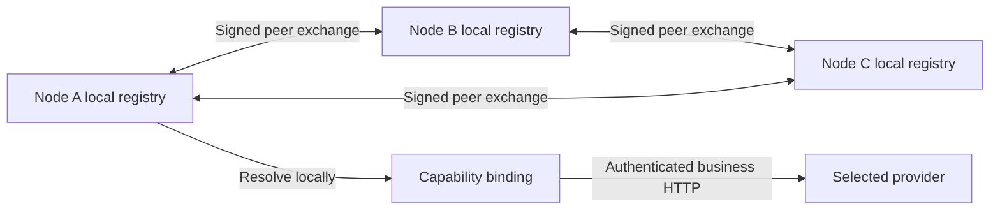

# WhaleMesh architecture

**Everything is Docker. Every Docker is an Equal Mesh Node.**

Every independently deployed business process embeds the same role-free Mesh SDK. A process can advertise several capabilities and resolve several dependencies. Deployment package names select linked business code; they are not protocol identities, resolver selectors or a role hierarchy.

## Control plane

Each node owns its manifest, verified identity, local membership view, capability registry and resolver. Bootstrap URLs are reachability hints only. Periodic authenticated peer exchange distributes signed manifests; each origin advances its own sequence. Local expiry is based on observing new origin progress, not repeated forwarding or comparing clocks from different machines. Each process restart gets a new random instance ID; persistent principal identity remains separately provisioned. Graceful draining excludes new bindings before shutdown.

The SDK knows capabilities, interface versions, constraints and trust. It does not know names such as runtime, llm, adapter or manager. A new capability needs no central routing-table change. No live central membership database or single mandatory seed exists.

## Data plane

Business capabilities have ordinary typed endpoints and operation descriptors. HTTP/JSON handles bounded requests; SSE carries streaming operations. The common layer supplies authenticated identity, authorization scopes, namespace checks, trace/request context, deadlines, structured errors, cancellation and reusable connections. A relay is an optional authenticated transport. The destination retains authorization; a relay does not become an application gateway or choose providers.

Capability publication is an independent permission from capability invocation. An origin must have a trusted public key, matching namespace and an administrator grant for each advertised capability. A trusted discovery peer without a provider grant cannot impersonate a model or secret store.

## Dependency resolution

A requirement names a capability and interface/version constraints, not a container role. Resolver filters lifecycle/readiness, version, namespace, trust scopes and attributes before applying a deterministic policy. Explanations expose exclusions and selected bindings. Explicit model/cost choices are never broadened merely to find an available provider.

Stateful storage stays bound to its provider boundary. Failure is an explicit error, not automatic data migration. Optional knowledge and telemetry can be absent without preventing chat. Required cycles must produce a diagnostic rather than an infinite startup wait.

## Business capability bundles

- Agent execution: durable user turn, bounded tool loop, explicit tool-export policy, argument-bound confirmation, retrieval, usage, traces and benchmark.
- Model access: multiple persisted model profiles, actual OpenAI-compatible calls, streamed responses, explicit mock development mode.
- Persistent capabilities: sessions, notes/search, encrypted secret resolution, skills, isolated workspace, events and statistics.
- Browser/Telegram: user authentication and adapter identity separate from node authentication. Both invoke discovered capabilities.
- Executor: privileged Engine boundary, owned resources, desired deployments, constrained child identities, image/resource/network policies and trusted administrator approvals.

Bundles may be combined or separated according to privilege, persistence and fault-domain requirements. They do not require a separate container for every function. Executor, relay, browser management, knowledge and telemetry are not required by the mesh protocol.

## Source layout

`pkg/mesh` contains protocol types, schema validation, discovery, resolution, signed clients/servers and lifecycle. `schemas` holds strict public schemas. `internal` holds ordinary business providers and optional transports. `cmd/node` embeds chosen bundles. `cmd/bootstrap` provisions deployment credentials offline. `cmd/chat` is a terminal consumer. `examples/hello` is an independent provider. `web` is the Svelte management and chat surface. Root Compose files describe Docker deployment, not business wiring.

See [legacy audit](legacy-audit.md), [ADRs](adr/), [single-host deployment](../single-host.md), and capability/schema guides for operational contracts.
